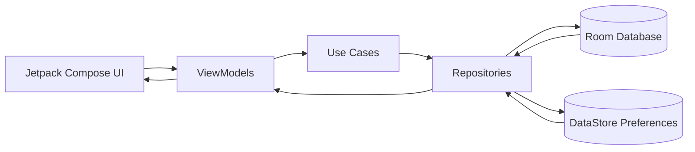

<div align="center">

# Sukoku — Offline Sudoku Game

**A polished, fully offline Sudoku experience for Android**

[](https://kotlinlang.org/)
[](https://developer.android.com)
[](https://developer.android.com/jetpack/compose)
[](#license)

**Sukoku** combines classic Sudoku puzzles with a clean Material 3 interface, automatic progress saving, useful gameplay tools, achievements, and detailed statistics — with no internet connection required.

</div>

---

## ✨ Highlights

<table>
  <tr>
    <td width="50%">

### 🧩 Play Sudoku

- Four difficulty levels: Easy, Medium, Hard, and Expert
- Random, valid puzzle generation
- Interactive 9×9 board with row, column, box, and number highlights
- Conflict feedback and configurable mistake limits
- Pause, reset, undo, and redo controls

</td>
<td width="50%">

### 📝 Smart Assistance

- Pencil notes and candidate mode
- Optional hints
- Dynamic number pad showing remaining digits
- Auto-save and game recovery
- Clean, distraction-free Material 3 design

</td>
  </tr>
  <tr>
    <td>

### 📊 Track Progress

- Games played, wins, losses, and win rate
- Total play time and average game duration
- Best times for every difficulty
- Current and longest streaks
- Hints usage statistics

</td>
<td>

### 🏆 Earn Achievements

- Reactive trophy collection
- Ten achievement milestones
- Progress tracking for each trophy
- Celebration effects after completing a game
- Motivational completion feedback

</td>
  </tr>
</table>

---

## 📱 Features

| Category | Included features |
|---|---|
| **Gameplay** | Random puzzles, 4 difficulties, hints, notes, undo/redo, reset, pause, mistake tracking |
| **Interface** | Jetpack Compose, Material 3, light/dark/system themes, animated cells, haptic and sound feedback |
| **Progress** | Automatic saving, continue-game support, statistics, best times, streaks |
| **Rewards** | 10 achievements, trophy room, victory celebration |
| **Offline** | Local Room database, DataStore preferences, no account or network required |

---

## 🏗️ Architecture

Sukoku follows a clean, modular architecture with unidirectional state flow:



### Project layers

- **`presentation`** — Compose screens, components, themes, and ViewModels
- **`domain`** — Models, game rules, and use cases
- **`data`** — Repositories, Room entities/DAOs, puzzle generation, and preferences
- **`di`** — Dagger Hilt dependency injection

---

## 🧰 Tech Stack

- **Language:** Kotlin
- **UI:** Jetpack Compose + Material 3
- **Architecture:** MVVM with Clean Architecture principles
- **State:** Kotlin Coroutines and StateFlow
- **Dependency Injection:** Dagger Hilt
- **Persistence:** Room Database and DataStore Preferences
- **Serialization:** Kotlin Serialization and Gson
- **Navigation:** Jetpack Navigation Compose
- **Feedback:** SoundPool, vibration, and Lottie Compose
- **Build:** Gradle Kotlin DSL

---

## 🚀 Getting Started

### Requirements

- Android Studio with current Kotlin and Android SDK support
- Android SDK 37
- Android device or emulator running **Android 12 (API 30)** or newer

### Installation

```bash
# Clone the repository
git clone https://github.com/It-Saurabh001/Project1.git

# Open the project in Android Studio
cd Project1

# Build and install on a connected device
./gradlew installDebug
```

You can also open `Project1` in Android Studio, let Gradle finish syncing, then press **Run**.

### Build a release APK

```bash
./gradlew assembleRelease
```

The generated APK is written to:

```text
app/build/outputs/apk/release/
```

---

## 🎮 How to Play

1. Choose a difficulty and start a new puzzle.
2. Tap an empty cell and enter a number from 1 to 9.
3. Use **Notes** mode to add or remove pencil marks.
4. Undo mistakes or use hints when needed.
5. Fill every empty cell with the correct number to complete the puzzle.

---

## 🗂️ Repository Structure

```text
Project1/
├── app/
│   ├── src/main/java/com/saurabh/sudoku/
│   │   ├── data/           # Database, repositories, and puzzle generation
│   │   ├── domain/         # Models and game use cases
│   │   ├── presentation/   # Compose screens, components, themes, and ViewModels
│   │   └── di/             # Hilt modules
│   ├── src/main/res/       # Resources and app manifest configuration
│   └── build.gradle.kts
├── gradle/
├── build.gradle.kts
└── settings.gradle.kts
```

---

## 🧪 Testing

Run the JVM unit tests with:

```bash
./gradlew testDebugUnitTest
```

The project includes coverage for puzzle generation, board and notes behavior, move validation, statistics, and ViewModel logic.

---

## ⚙️ Configuration

Sukoku uses a local database and preferences—no API keys or remote services are required.

| Setting | Options |
|---|---|
| Theme | Light, Dark, or System |
| Difficulty | Easy, Medium, Hard, Expert |
| Sound effects | On / Off |
| Haptic feedback | On / Off |
| Notes mode | Standard / Pencil mode |
| Error highlighting | On / Off |
| Auto-save | On / Off |

---

## 🤝 Contributing

Contributions are welcome.

1. Fork the repository.
2. Create a feature branch:
   ```bash
   git checkout -b feature/your-feature
   ```
3. Commit your changes.
4. Push the branch and open a pull request.

Please keep changes focused and add tests for gameplay or data-related behavior.

---

## 📄 License

This project is distributed under the MIT License. See `LICENSE` if a license file is added to the repository.

---

<div align="center">

Made with Kotlin, Jetpack Compose, and a love for puzzles.

</div>
